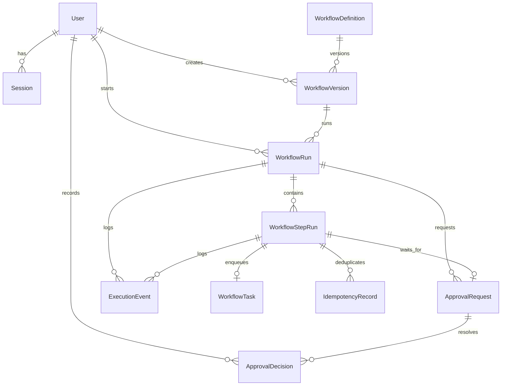

# Domain Model

## Entities

### User
- Schema/model file: [prisma/schema.prisma](../../prisma/schema.prisma) — `model User`
- Primary service owner: [src/services/auth-service.ts](../../src/services/auth-service.ts) — `loginUser()`
- Notes: Users carry the role that [src/lib/auth/permissions.ts](../../src/lib/auth/permissions.ts) maps to permissions.

### Session
- Schema/model file: [prisma/schema.prisma](../../prisma/schema.prisma) — `model Session`
- Primary service owner: [src/lib/auth/session.ts](../../src/lib/auth/session.ts) — `createSession()`, `getUserFromSessionToken()`, `destroySession()`
- Notes: Sessions are DB-backed and cookie-delivered, not JWT-only.

### WorkflowDefinition
- Schema/model file: [prisma/schema.prisma](../../prisma/schema.prisma) — `model WorkflowDefinition`
- Primary service owner: [src/services/workflow-definition-service.ts](../../src/services/workflow-definition-service.ts) — `createWorkflowDefinitionVersion()`
- Notes: This is the stable top-level identity (`key`, `name`, metadata).

### WorkflowVersion
- Schema/model file: [prisma/schema.prisma](../../prisma/schema.prisma) — `model WorkflowVersion`
- Primary service owner: [src/services/workflow-definition-service.ts](../../src/services/workflow-definition-service.ts) — `createWorkflowDefinitionVersion()`
- Notes: The actual executable workflow JSON lives in `definition` and is validated by `workflowDefinitionSchema` in [src/lib/workflows/definition-schema.ts](../../src/lib/workflows/definition-schema.ts).

### WorkflowRun
- Schema/model file: [prisma/schema.prisma](../../prisma/schema.prisma) — `model WorkflowRun`
- Primary service owner: [src/services/workflow-run-service.ts](../../src/services/workflow-run-service.ts) — `startWorkflowRun()`
- Notes: A run is pinned to one workflow version and carries mutable execution state like `status`, `context`, `currentStepKey`, and `lastError`.

### WorkflowStepRun
- Schema/model file: [prisma/schema.prisma](../../prisma/schema.prisma) — `model WorkflowStepRun`
- Primary service owner: [src/services/workflow-engine-service.ts](../../src/services/workflow-engine-service.ts) — `createTaskStep()`, `createApprovalStep()`, `createConditionStep()`
- Notes: Each logical step in the workflow definition gets one durable row with attempt counts, backoff, and status.

### WorkflowTask
- Schema/model file: [prisma/schema.prisma](../../prisma/schema.prisma) — `model WorkflowTask`
- Primary service owner: [src/services/worker-service.ts](../../src/services/worker-service.ts) — `processNextTask()`
- Notes: This is the durable worker queue item. Leasing logic lives in [src/repositories/task-repository.ts](../../src/repositories/task-repository.ts) — `claimNextAvailableTask()`.

### ApprovalRequest
- Schema/model file: [prisma/schema.prisma](../../prisma/schema.prisma) — `model ApprovalRequest`
- Primary service owner: [src/services/approval-service.ts](../../src/services/approval-service.ts) — `submitApprovalDecision()`
- Notes: Approval waits are first-class rows because they outlive worker leases and app restarts.

### ApprovalDecision
- Schema/model file: [prisma/schema.prisma](../../prisma/schema.prisma) — `model ApprovalDecision`
- Primary service owner: [src/services/workflow-engine-service.ts](../../src/services/workflow-engine-service.ts) — `resolveApprovalStep()`
- Notes: This captures the actor and comment so approval history is auditable.

### IdempotencyRecord
- Schema/model file: [prisma/schema.prisma](../../prisma/schema.prisma) — `model IdempotencyRecord`
- Primary service owner: [src/services/worker-service.ts](../../src/services/worker-service.ts) — `runIdempotentAction()`
- Notes: This stores side-effect results so a retry can reuse them. The record is written only after the side effect returns (`src/services/worker-service.ts:45-55`), so effects are at-least-once, not exactly-once.

### ExecutionEvent
- Schema/model file: [prisma/schema.prisma](../../prisma/schema.prisma) — `model ExecutionEvent`
- Primary service owner: [src/services/workflow-engine-service.ts](../../src/services/workflow-engine-service.ts) — `appendExecutionEvent()` calls throughout the engine
- Notes: Mutable state lives on `WorkflowRun` and `WorkflowStepRun`; append-only history lives here.

## Constraints that shape behaviour

The ER diagram shows relationships. These database constraints in `prisma/schema.prisma` decide what the engine can and cannot do at runtime.

| Constraint | Line | Consequence |
| --- | --- | --- |
| `WorkflowRun.idempotencyKey @unique` (nullable) | 157 | Two concurrent `POST /api/workflow-runs` with the same key: both pass the `findWorkflowRunByIdempotencyKey()` check (`src/services/workflow-run-service.ts:52-56`), the second `create` hits the unique index, and because the resulting Prisma error is not an `ApiError` the caller gets a 500 rather than the existing run. |
| `WorkflowStepRun @@unique([workflowRunId, stepKey])` | 203 | One row per step per run. Retries reuse the same row (`workflow-engine-service.ts:556`), and a graph that revisits a step cannot run (see finding F7 in `docs/architecture/README.md`). |
| `WorkflowStepRun.idempotencyKey @unique` | 186 | Always `${runId}:${stepKey}` (`workflow-engine-service.ts:176`, `:232`, `:290`), so it duplicates the composite unique above rather than adding protection. |
| `WorkflowTask.stepRunId @unique` | 210 | Exactly one queue row per task step. A retry flips the same row back to `AVAILABLE` (`workflow-engine-service.ts:557-564`) instead of inserting a new one. |
| `ApprovalRequest.stepRunId @unique` | 231 | One approval row per approval step. It does **not** stop two decisions landing on that row: `ApprovalDecision` has no uniqueness on `approvalRequestId` (lines 245-256). |
| `IdempotencyRecord.key @unique` | 260 | Makes the `runOnce()` record insert fail for a second writer, which `runIdempotentAction()` catches and resolves by re-reading (`src/services/worker-service.ts:56-64`). |
| `onDelete: Cascade` on `ExecutionEvent.workflowRun` | 282 | The "append-only" history is append-only by convention only. Deleting a run deletes its events, and nothing at the database level prevents `UPDATE` on event rows. |

## Enum values that exist but are never produced

Counted with `grep` over `src/` and `prisma/seed.ts` (excluding `schema.prisma`):

- `VersionStatus.DRAFT`, `DefinitionStatus.ARCHIVED`, `ExecutionEventType.SYSTEM_NOTE`: zero uses.
- `RunStatus.CANCELLED` and `StepRunStatus.SKIPPED`: appear only in the transition table `src/lib/workflows/run-state-machine.ts`; no code sets them.
- `StepRunStatus.PENDING`: steps are created directly as `QUEUED`, `WAITING_APPROVAL` or `SUCCEEDED` (`workflow-engine-service.ts:172`, `:229`, `:286`). The `fromStatus: "PENDING"` on the matching events (`:199`, `:258`, `:310`) is written by hand to make the history read naturally; the row itself never held that status.

Knowing this stops you writing UI or queries for states that cannot occur, and shows you what a "cancel run" or "skip step" feature would have to add.

## Fields written but never read

| Field | Written at | Read anywhere? |
| --- | --- | --- |
| `WorkflowTask.leaseExpiresAt` | `src/repositories/task-repository.ts:69` | No. There is no lease-reclaim query. |
| `WorkflowTask.leaseToken` | `task-repository.ts:68` | No. `completeTaskStep()` and `failTaskStep()` never compare it, so a stale worker could not be fenced off even if leases were reclaimed. |
| `WorkflowRun.nextWakeAt` | `src/services/workflow-engine-service.ts:577` | No. No scheduler wakes runs; the task row's `availableAt` does the real work. |
| `WorkflowStepRun.leaseExpiresAt` | `workflow-engine-service.ts:401` | Only displayed or cleared, never enforced. |

## Exercise: read the model like a reviewer

**Goal:** be able to say, for any row, which code path creates it and which moves it.

1. Pick `WorkflowTask`. Find every call that changes its `status`.
   **Check:** you should find exactly four places: the raw SQL claim (`task-repository.ts:66`, sets `LEASED`), `completeTaskStep()` (`workflow-engine-service.ts:471`, `COMPLETED`), and two in `failTaskStep()` (`:542` `FAILED`, `:558` `AVAILABLE`). No path sets `LEASED` back to `AVAILABLE` without a worker calling in, which is finding F1.
2. Pick `ApprovalRequest.status`. Find every writer.
   **Check:** one writer, `resolveApprovalRequest()` (`src/repositories/approval-repository.ts:77-86`), called only from `resolveApprovalStep()` (`workflow-engine-service.ts:636-640`). Its `where` clause is `{ id }`, with no status guard.
3. Explain why `ExecutionEvent` is not a real event store.
   **Check:** nothing in `src/` reads events to compute state; they are only rendered (`src/components/runs/run-detail.tsx`) and returned by `findWorkflowRunById()` (`workflow-run-repository.ts:80-82`).
